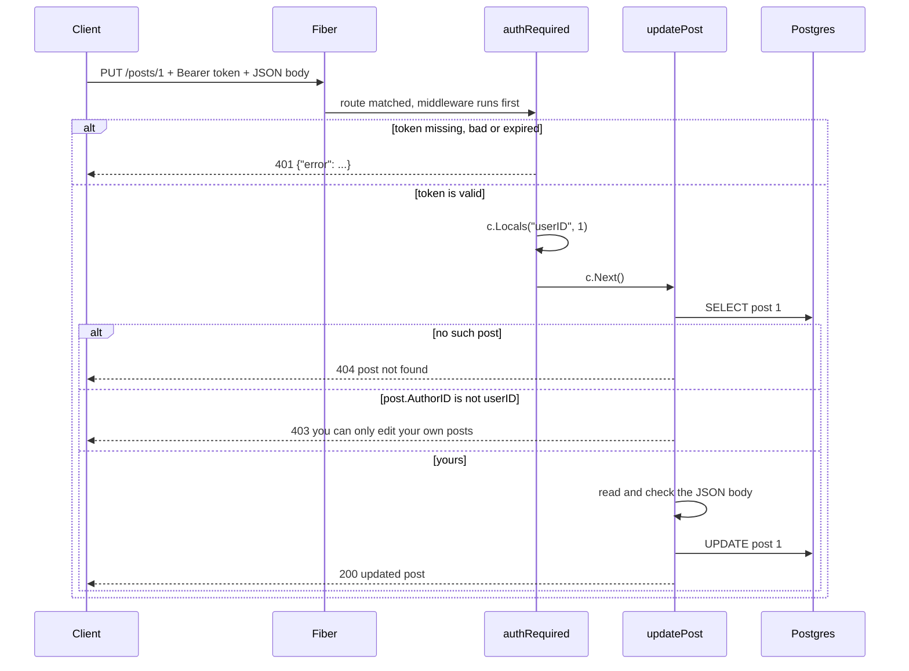
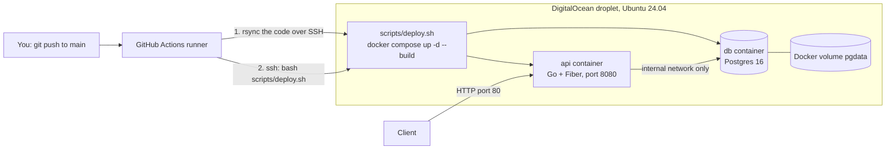

# Build a Simple Blog API in Go (Fiber v3 + GORM + JWT)

This is the **Fiber v3** version. **Part 1** (sections 1 to 9) builds a small REST API where people can **register**, **log in**, and **create, read, update and delete blog posts**. Only logged-in users can write, and you can only change or delete **your own** posts. **Part 2** (sections 10 to 18) puts it in Docker with a Postgres container and deploys it to a DigitalOcean droplet with a GitHub Actions workflow that builds the images on the droplet over SSH.

> **Status.** I wrote this code carefully and checked its syntax, but I could **not compile or run it** where I wrote it (Go's module download was blocked there, and Fiber v3 needs a newer Go than that machine had). The Fiber v3 calls were checked against the official docs (links at the end). The "expected output" blocks in section 6 show the shape of the replies; ids, timestamps and the token will differ on your machine.
>
> **Deployment files (Part 2):** I checked that `docker-compose.yml` renders correctly with `docker compose config` (including the "missing variable" errors), that `scripts/deploy.sh` has valid shell syntax, and that the workflow YAML parses. I could **not** build the images, run the containers, lint the workflow, or try any step on a real droplet, so your first deploy is the real test. Sections 8 and 18 list the usual causes if something fails.

**Contents**

1. [What we are building](#1-what-we-are-building)
2. [Setup](#2-setup)
3. [Project layout](#3-project-layout)
4. [The code, file by file](#4-the-code-file-by-file)
5. [Run it](#5-run-it)
6. [Try every endpoint](#6-try-every-endpoint)
7. [How a request flows](#7-how-a-request-flows)
8. [Common errors](#8-common-errors)
9. [Next steps](#9-next-steps)

**Part 2: deploy on a DigitalOcean droplet**

10. [The plan](#10-the-plan)
11. [The Docker files](#11-the-docker-files)
12. [Try it locally first](#12-try-it-locally-first)
13. [Set up the DigitalOcean environment](#13-set-up-the-digitalocean-environment)
14. [Set up GitHub](#14-set-up-github)
15. [The deploy script and the workflow](#15-the-deploy-script-and-the-workflow)
16. [First deploy and day-to-day use](#16-first-deploy-and-day-to-day-use)
17. [Add HTTPS with a domain](#17-add-https-with-a-domain-recommended)
18. [Troubleshooting the deployment](#18-troubleshooting-the-deployment)

---

## 1. What we are building

| Method | Path | Login needed? | What it does | Success status |
|---|---|---|---|---|
| GET | `/health` | no | "is the server up?" | 200 |
| POST | `/auth/register` | no | create an account | 201 |
| POST | `/auth/login` | no | get a JWT token | 200 |
| GET | `/posts` | no | list the newest 50 posts | 200 |
| GET | `/posts/:id` | no | read one post | 200 |
| POST | `/posts` | **yes** | create a post | 201 |
| PUT | `/posts/:id` | **yes, author only** | update a post | 200 |
| DELETE | `/posts/:id` | **yes, author only** | delete a post | 204 |

**The tools**

- **Fiber v3**: the web framework (routes, request and response). It feels like Express.
- **GORM**: talks to the database. You describe tables as Go structs and it writes the SQL.
- **JWT**: after login the server gives you a signed token. You send it back in the `Authorization` header so the server knows who you are, without a session.
- **bcrypt**: turns a password into a hash. We store only the hash, never the password.

---

## 2. Setup

You need Go and Docker for the database. **Fiber v3 needs a recent Go**: its docs say Go 1.26 or later. Check with `go version`, and install the newest release from <https://go.dev/dl/> if yours is older.

**Start Postgres:**

```bash
docker run -d --name blogdb -e POSTGRES_PASSWORD=pass -e POSTGRES_DB=blog -p 5432:5432 postgres:16
```

**Create the project:**

```bash
mkdir blogapi && cd blogapi
go mod init blogapi          # creates go.mod (like package.json)
```

**Create the four files from section 4**, then download the libraries:

```bash
go mod tidy                  # finds every import (including fiber/v3) and downloads it
```

---

## 3. Project layout

```
blogapi/
├── go.mod
├── go.sum                      # created by "go mod tidy"; commit it
├── main.go                     # starts the server, connects to the DB, lists the routes
├── models.go                   # the two tables: User and Post
├── auth.go                     # register, login, and the "are you logged in?" middleware
├── posts.go                    # create / read / update / delete for posts
│
│   # ----- added in Part 2 (deployment) -----
├── Dockerfile                  # the API image               (section 11)
├── docker-compose.yml          # runs db + api together      (section 11)
├── db/
│   └── Dockerfile              # the Postgres image          (section 11)
├── scripts/
│   └── deploy.sh               # runs ON the droplet         (section 15)
├── .github/
│   └── workflows/
│       └── deploy.yml          # GitHub Actions workflow     (section 15)
├── .env.example                # template for the real .env  (section 11)
├── .dockerignore
└── .gitignore
```

All four Go files start with `package main`, so Go builds them together as one program. The deployment files are not Go code; Part 2 explains each one.

---

## 4. The code, file by file

### Fiber v2 to v3: what is different

If you have seen Fiber v2 code (including the earlier guides), these are the changes you will notice. Everything else (routes, `c.JSON`, `c.Status`, `c.Get`, `c.Next`, `fiber.NewError`) works the same.

| Fiber v2 | Fiber v3 | Why you care |
|---|---|---|
| `import ".../fiber/v2"` | `import ".../fiber/v3"` | Also for `middleware/logger` and `middleware/recover`. |
| `func(c *fiber.Ctx) error` | `func(c fiber.Ctx) error` | `fiber.Ctx` is now an **interface**, so there is no `*`. |
| `c.BodyParser(&in)` | `c.Bind().Body(&in)` | `BodyParser` was removed. |
| `id, err := c.ParamsInt("id")` | `id := fiber.Params[int](c, "id", 0)` | Generic helper. It returns the default (`0`) if the value is not a number, so there is no error to check. |
| `c.Locals("userID", id)` and `c.Locals("userID").(uint)` | `fiber.Locals[uint](c, "userID", id)` and `fiber.Locals[uint](c, "userID")` | Typed in and out, so the `.(uint)` type assertion (which could panic) is gone. |
| `err.(*fiber.Error)` in the error handler | `errors.As(err, &e)` | The recommended way to read a `*fiber.Error`. |
| `c.UserContext()` | pass `c` itself | `fiber.Ctx` implements `context.Context`. (Used in the Cloud Run guide, not here.) |

The generic form `fiber.Params[int](...)` means "read this URL part and convert it to an `int`". The `[int]` is a **type parameter**. You choose the type you want back.

### `models.go`: the tables

```go
package main

import "time"

// User is a row in the "users" table.
type User struct {
    ID           uint      `gorm:"primaryKey" json:"id"`
    Email        string    `gorm:"uniqueIndex;not null;size:255" json:"email"`
    PasswordHash string    `gorm:"not null" json:"-"` // json:"-" means: never send this to clients
    CreatedAt    time.Time `json:"created_at"`
}

// Post is a row in the "posts" table.
type Post struct {
    ID        uint      `gorm:"primaryKey" json:"id"`
    Title     string    `gorm:"not null;size:200" json:"title"`
    Content   string    `gorm:"type:text;not null" json:"content"`
    AuthorID  uint      `gorm:"index;not null" json:"author_id"` // which user wrote it
    CreatedAt time.Time `json:"created_at"`
    UpdatedAt time.Time `json:"updated_at"`
}
```

- A **struct** is a bundle of named fields. Each struct becomes a table: `User` becomes `users`, `Post` becomes `posts`. Field `CreatedAt` becomes column `created_at`.
- The text in backticks is a **tag**. `gorm:"..."` sets database rules (`uniqueIndex` means no two users can share an email, `not null` means the column must be filled in). `json:"..."` sets the name used in JSON replies.
- `json:"-"` on `PasswordHash` means that field is **never** included in any JSON reply.
- `AuthorID` is the id of the user who wrote the post. We compare it with the logged-in user's id to decide who may edit or delete.
- `CreatedAt` and `UpdatedAt` are filled in by GORM automatically.
- Field names start with a capital letter. In Go that makes them visible to other packages, and GORM and the JSON library need that.

### `auth.go`: register, login, and the login check

```go
package main

import (
    "errors"
    "os"
    "strconv"
    "strings"
    "time"

    "github.com/gofiber/fiber/v3"
    "github.com/golang-jwt/jwt/v5"
    "golang.org/x/crypto/bcrypt"
    "gorm.io/gorm"
)

var jwtSecret = []byte(os.Getenv("JWT_SECRET"))

type credentials struct {
    Email    string `json:"email"`
    Password string `json:"password"`
}

func register(db *gorm.DB) fiber.Handler {
    return func(c fiber.Ctx) error {
        var in credentials
        if err := c.Bind().Body(&in); err != nil {
            return fiber.NewError(fiber.StatusBadRequest, "invalid JSON")
        }
        in.Email = strings.ToLower(strings.TrimSpace(in.Email))
        if !strings.Contains(in.Email, "@") || len(in.Password) < 8 {
            return fiber.NewError(fiber.StatusBadRequest, "valid email and password (8+ chars) required")
        }

        hash, err := bcrypt.GenerateFromPassword([]byte(in.Password), bcrypt.DefaultCost)
        if err != nil {
            return err
        }
        user := User{Email: in.Email, PasswordHash: string(hash)}
        if err := db.Create(&user).Error; err != nil {
            if errors.Is(err, gorm.ErrDuplicatedKey) || strings.Contains(err.Error(), "duplicate") {
                return fiber.NewError(fiber.StatusConflict, "email already registered")
            }
            return err
        }
        return c.Status(fiber.StatusCreated).JSON(user)
    }
}

func login(db *gorm.DB) fiber.Handler {
    return func(c fiber.Ctx) error {
        var in credentials
        if err := c.Bind().Body(&in); err != nil {
            return fiber.NewError(fiber.StatusBadRequest, "invalid JSON")
        }
        var user User
        err := db.Where("email = ?", strings.ToLower(strings.TrimSpace(in.Email))).First(&user).Error
        // same message for "no user" and "wrong password" (don't leak which)
        if err != nil || bcrypt.CompareHashAndPassword([]byte(user.PasswordHash), []byte(in.Password)) != nil {
            return fiber.NewError(fiber.StatusUnauthorized, "invalid email or password")
        }

        claims := jwt.RegisteredClaims{
            Subject:   strconv.FormatUint(uint64(user.ID), 10),
            IssuedAt:  jwt.NewNumericDate(time.Now()),
            ExpiresAt: jwt.NewNumericDate(time.Now().Add(24 * time.Hour)),
        }
        token, err := jwt.NewWithClaims(jwt.SigningMethodHS256, claims).SignedString(jwtSecret)
        if err != nil {
            return err
        }
        return c.JSON(fiber.Map{"token": token})
    }
}

// Middleware: runs before protected handlers.
func authRequired(c fiber.Ctx) error {
    header := c.Get("Authorization")
    if !strings.HasPrefix(header, "Bearer ") {
        return fiber.NewError(fiber.StatusUnauthorized, "missing bearer token")
    }
    raw := strings.TrimPrefix(header, "Bearer ")

    claims := &jwt.RegisteredClaims{}
    token, err := jwt.ParseWithClaims(raw, claims,
        func(t *jwt.Token) (any, error) { return jwtSecret, nil },
        jwt.WithValidMethods([]string{"HS256"}), // reject other algorithms
    )
    if err != nil || !token.Valid {
        return fiber.NewError(fiber.StatusUnauthorized, "invalid or expired token")
    }
    id, err := strconv.ParseUint(claims.Subject, 10, 64)
    if err != nil {
        return fiber.NewError(fiber.StatusUnauthorized, "bad token subject")
    }
    fiber.Locals[uint](c, "userID", uint(id)) // pass to later handlers
    return c.Next()
}
```

- `jwtSecret` is the key used to sign tokens. It comes from the `JWT_SECRET` environment variable, so it never appears in your code.
- `credentials` is the JSON body for register and login: `{"email": "...", "password": "..."}`.
- **`register`** (a function that returns a handler):
  - `c.Bind().Body(&in)` fills `in` from the JSON body. We pass `&in` (its address) so the binder can write into our variable. It picks the decoder from the `Content-Type` header, so the header must be `application/json`.
  - It lowercases the email, checks it looks valid and that the password is at least 8 characters.
  - `bcrypt.GenerateFromPassword` makes the password hash. `[]byte(...)` converts the string to bytes, which is what the function wants.
  - `db.Create(&user)` inserts the row. If the email already exists the database refuses, and we reply `409`.
- **`login`**:
  - Finds the user by email, then `bcrypt.CompareHashAndPassword` checks the password against the stored hash.
  - The same message ("invalid email or password") is used whether the email or the password was wrong, so nobody can use the API to find out which emails are registered.
  - It builds **claims** (who the token is for, when it was issued, when it expires in 24 hours), signs them with `jwtSecret`, and returns the token.
- **`authRequired`** is a **middleware**: a function that runs *before* a route's handler.
  - It reads the `Authorization: Bearer <token>` header and verifies the signature and expiry.
  - `jwt.WithValidMethods([]string{"HS256"})` rejects tokens signed with any other algorithm.
  - On success it stores the user id with `fiber.Locals[uint](c, "userID", ...)` and calls `c.Next()` to continue to the real handler. On failure it returns a `401` and the handler never runs.

### `posts.go`: create, read, update, delete

```go
package main

import (
    "errors"
    "strings"

    "github.com/gofiber/fiber/v3"
    "gorm.io/gorm"
)

// postInput is the JSON body for creating or updating a post.
type postInput struct {
    Title   string `json:"title"`
    Content string `json:"content"`
}

// readInput parses the body and checks that both fields are filled in.
func readInput(c fiber.Ctx) (postInput, error) {
    var in postInput
    if err := c.Bind().Body(&in); err != nil {
        return in, fiber.NewError(fiber.StatusBadRequest, "invalid JSON")
    }
    in.Title = strings.TrimSpace(in.Title)
    in.Content = strings.TrimSpace(in.Content)
    if in.Title == "" || in.Content == "" {
        return in, fiber.NewError(fiber.StatusBadRequest, "title and content are required")
    }
    return in, nil
}

// findPost loads the post whose id is in the URL (/posts/:id).
func findPost(db *gorm.DB, c fiber.Ctx) (Post, error) {
    id := fiber.Params[int](c, "id", 0) // 0 if the URL part is not a number
    if id <= 0 {
        return Post{}, fiber.NewError(fiber.StatusBadRequest, "id must be a positive number")
    }

    var post Post
    err := db.First(&post, id).Error
    if errors.Is(err, gorm.ErrRecordNotFound) {
        return Post{}, fiber.NewError(fiber.StatusNotFound, "post not found")
    }
    if err != nil {
        return Post{}, err // a real database problem
    }
    return post, nil
}

// ---------- READ (public) ----------

func listPosts(db *gorm.DB) fiber.Handler {
    return func(c fiber.Ctx) error {
        var posts []Post
        err := db.Order("id desc").Limit(50).Find(&posts).Error // newest first
        if err != nil {
            return err
        }
        return c.JSON(posts)
    }
}

func getPost(db *gorm.DB) fiber.Handler {
    return func(c fiber.Ctx) error {
        post, err := findPost(db, c)
        if err != nil {
            return err
        }
        return c.JSON(post)
    }
}

// ---------- CREATE (login required) ----------

func createPost(db *gorm.DB) fiber.Handler {
    return func(c fiber.Ctx) error {
        in, err := readInput(c)
        if err != nil {
            return err
        }

        post := Post{
            Title:    in.Title,
            Content:  in.Content,
            AuthorID: fiber.Locals[uint](c, "userID"), // set by the authRequired middleware
        }
        if err := db.Create(&post).Error; err != nil {
            return err
        }
        return c.Status(fiber.StatusCreated).JSON(post)
    }
}

// ---------- UPDATE (login required, only the author) ----------

func updatePost(db *gorm.DB) fiber.Handler {
    return func(c fiber.Ctx) error {
        post, err := findPost(db, c)
        if err != nil {
            return err
        }
        if post.AuthorID != fiber.Locals[uint](c, "userID") {
            return fiber.NewError(fiber.StatusForbidden, "you can only edit your own posts")
        }

        in, err := readInput(c)
        if err != nil {
            return err
        }
        post.Title = in.Title
        post.Content = in.Content
        if err := db.Save(&post).Error; err != nil { // Save also refreshes updated_at
            return err
        }
        return c.JSON(post)
    }
}

// ---------- DELETE (login required, only the author) ----------

func deletePost(db *gorm.DB) fiber.Handler {
    return func(c fiber.Ctx) error {
        post, err := findPost(db, c)
        if err != nil {
            return err
        }
        if post.AuthorID != fiber.Locals[uint](c, "userID") {
            return fiber.NewError(fiber.StatusForbidden, "you can only delete your own posts")
        }

        if err := db.Delete(&post).Error; err != nil {
            return err
        }
        return c.SendStatus(fiber.StatusNoContent) // 204: success, nothing to send back
    }
}
```

**The helpers**

- `postInput` is the JSON body for creating or updating: `{"title": "...", "content": "..."}`.
- `readInput` parses the body and returns a `400` if the title or content is empty. `strings.TrimSpace` removes spaces at both ends, so a title of only spaces counts as empty.
- `findPost` is used by get, update and delete:
  - `fiber.Params[int](c, "id", 0)` reads the number from the URL (`/posts/5` gives `5`). If it is not a number it gives the default `0`, and we reply `400` for any id that is not above zero.
  - `db.First(&post, id)` loads the post. `errors.Is(err, gorm.ErrRecordNotFound)` means "no such row", so we reply `404`. Any other error is a real database problem.

**The handlers**

- `listPosts` (public): `Order("id desc").Limit(50).Find(&posts)` loads the newest 50 posts into the `posts` slice (Go's list type).
- `getPost` (public): calls `findPost` and returns it.
- `createPost`: reads the input, fills a `Post` with `AuthorID` from `c.Locals("userID")`, and inserts it. `fiber.Locals[uint](c, "userID")` reads the id the middleware stored, already typed as a `uint`. The status is `201 Created`.
- `updatePost`: loads the post, then checks `post.AuthorID` against the logged-in user. If they differ the reply is `403 Forbidden`. It checks ownership **before** reading the body, so strangers learn nothing. `db.Save(&post)` writes all fields and refreshes `updated_at`.
- `deletePost`: same ownership check, then `db.Delete(&post)`. We answer `204 No Content`: success, with an empty body.

**Why `401` and `403` are different:** `401` means "I don't know who you are" (missing or bad token). `403` means "I know who you are, but this is not yours".

### `main.go`: wiring it all together

```go
package main

import (
    "errors"
    "log"
    "os"

    "github.com/gofiber/fiber/v3"
    "github.com/gofiber/fiber/v3/middleware/logger"
    "github.com/gofiber/fiber/v3/middleware/recover"
    "gorm.io/driver/postgres"
    "gorm.io/gorm"
)

func main() {
    // 1. check the settings
    if len(jwtSecret) < 32 {
        log.Fatal("JWT_SECRET must be set and at least 32 characters")
    }

    // 2. connect to the database and create the tables
    db, err := gorm.Open(postgres.Open(os.Getenv("DATABASE_URL")), &gorm.Config{})
    if err != nil {
        log.Fatal("db connect: ", err)
    }
    if err := db.AutoMigrate(&User{}, &Post{}); err != nil {
        log.Fatal("migrate: ", err)
    }

    // 3. create the web app. Every error becomes a JSON reply like {"error": "..."}
    app := fiber.New(fiber.Config{
        ErrorHandler: func(c fiber.Ctx, err error) error {
            code := fiber.StatusInternalServerError
            msg := "internal error"
            var e *fiber.Error
            if errors.As(err, &e) { // errors we made with fiber.NewError
                code, msg = e.Code, e.Message
            } else {
                log.Println("error:", err) // log the real reason, hide it from the client
            }
            return c.Status(code).JSON(fiber.Map{"error": msg})
        },
    })
    app.Use(recover.New(), logger.New()) // recover = a crash becomes a 500, not a dead server

    // 4. routes
    app.Get("/health", func(c fiber.Ctx) error { return c.SendString("ok") })

    app.Post("/auth/register", register(db))
    app.Post("/auth/login", login(db))

    // public: anyone can read
    app.Get("/posts", listPosts(db))
    app.Get("/posts/:id", getPost(db))

    // protected: authRequired runs first and stops the request if the token is bad
    app.Post("/posts", authRequired, createPost(db))
    app.Put("/posts/:id", authRequired, updatePost(db))
    app.Delete("/posts/:id", authRequired, deletePost(db))

    // 5. start (Cloud Run and most hosts give us PORT)
    port := os.Getenv("PORT")
    if port == "" {
        port = "8080"
    }
    log.Fatal(app.Listen(":" + port))
}
```

- Step 1 refuses to start without a good `JWT_SECRET` (32 or more characters), so you never run with a weak key by accident.
- Step 2 connects with `DATABASE_URL`. `db.AutoMigrate(&User{}, &Post{})` creates the tables if they are missing.
- Step 3 builds the Fiber app. The `ErrorHandler` is the one place that turns every returned error into JSON like `{"error": "post not found"}`. `errors.As` checks whether the error is one we made with `fiber.NewError`; if so it keeps its message and status. Any other error is logged, and the client only sees `internal error`, so database details never leak.
- In v3, panics are **not** recovered by default, so `recover.New()` matters: it turns a crash inside a handler into a `500` reply instead of killing the server. `logger.New()` prints one line per request.
- Step 4 lists the routes. For the protected ones, `authRequired` is placed **before** the handler, so it runs first. Doing it per route (instead of using a route group) keeps it obvious which routes need login, and the order of your routes cannot accidentally make a public route protected.
- Step 5 starts listening on `PORT` (default `8080`).

---

## 5. Run it

```bash
export DATABASE_URL="host=localhost user=postgres password=pass dbname=blog port=5432 sslmode=disable"
export JWT_SECRET="$(openssl rand -hex 32)"      # 64 random characters
go run .
```

Keep this terminal open. Open a second terminal for the next section. On Windows PowerShell, use `$env:DATABASE_URL="..."` and set `$env:JWT_SECRET` to any random string of 32 or more characters.

---

## 6. Try every endpoint

`curl -s -w '\nHTTP %{http_code}\n'` prints the reply and then the status code. `jq` (optional) pulls the token out of the JSON.

**Health check**

```bash
curl -s -w '\nHTTP %{http_code}\n' localhost:8080/health
```

```
ok
HTTP 200
```

**Register** (first user)

```bash
curl -s -w '\nHTTP %{http_code}\n' -X POST localhost:8080/auth/register \
  -H 'Content-Type: application/json' \
  -d '{"email":"asha@x.com","password":"supersecret1"}'
```

Expected output (the time will differ):

```
{"id":1,"email":"asha@x.com","created_at":"2026-11-05T10:00:00.123456+05:30"}
HTTP 201
```

Notice there is no `password_hash` in the reply. That is `json:"-"` at work. Registering the same email again gives:

```
{"error":"email already registered"}
HTTP 409
```

**Log in and save the token**

```bash
TOKEN=$(curl -s -X POST localhost:8080/auth/login \
  -H 'Content-Type: application/json' \
  -d '{"email":"asha@x.com","password":"supersecret1"}' | jq -r .token)

echo $TOKEN
```

Expected: a long string of three parts separated by dots, starting with `eyJ`. Without `jq`, run the login request on its own, then copy the value of `token` by hand.

**Create a post** (needs the token)

```bash
curl -s -w '\nHTTP %{http_code}\n' -X POST localhost:8080/posts \
  -H "Authorization: Bearer $TOKEN" \
  -H 'Content-Type: application/json' \
  -d '{"title":"My first post","content":"Hello from Go!"}'
```

```
{"id":1,"title":"My first post","content":"Hello from Go!","author_id":1,"created_at":"2026-11-05T10:01:00.5+05:30","updated_at":"2026-11-05T10:01:00.5+05:30"}
HTTP 201
```

**Create without a token**

```bash
curl -s -w '\nHTTP %{http_code}\n' -X POST localhost:8080/posts \
  -H 'Content-Type: application/json' -d '{"title":"x","content":"y"}'
```

```
{"error":"missing bearer token"}
HTTP 401
```

**Create with an empty title**

```bash
curl -s -w '\nHTTP %{http_code}\n' -X POST localhost:8080/posts \
  -H "Authorization: Bearer $TOKEN" -H 'Content-Type: application/json' \
  -d '{"title":"","content":"y"}'
```

```
{"error":"title and content are required"}
HTTP 400
```

**List all posts** (no token needed)

```bash
curl -s -w '\nHTTP %{http_code}\n' localhost:8080/posts
```

```
[{"id":1,"title":"My first post","content":"Hello from Go!","author_id":1,"created_at":"...","updated_at":"..."}]
HTTP 200
```

**Read one post**

```bash
curl -s -w '\nHTTP %{http_code}\n' localhost:8080/posts/1
```

```
{"id":1,"title":"My first post","content":"Hello from Go!","author_id":1,"created_at":"...","updated_at":"..."}
HTTP 200
```

```bash
curl -s -w '\nHTTP %{http_code}\n' localhost:8080/posts/999     # does not exist
curl -s -w '\nHTTP %{http_code}\n' localhost:8080/posts/abc     # not a number
```

```
{"error":"post not found"}
HTTP 404
{"error":"id must be a positive number"}
HTTP 400
```

**Update your post**

```bash
curl -s -w '\nHTTP %{http_code}\n' -X PUT localhost:8080/posts/1 \
  -H "Authorization: Bearer $TOKEN" -H 'Content-Type: application/json' \
  -d '{"title":"My first post (edited)","content":"Hello again from Go!"}'
```

```
{"id":1,"title":"My first post (edited)","content":"Hello again from Go!","author_id":1,"created_at":"...","updated_at":"..."}
HTTP 200
```

`updated_at` is now later than `created_at`.

**Try to edit someone else's post.** Register a second user, log in as them, and try:

```bash
curl -s -X POST localhost:8080/auth/register -H 'Content-Type: application/json' \
  -d '{"email":"ravi@x.com","password":"supersecret2"}' > /dev/null

TOKEN2=$(curl -s -X POST localhost:8080/auth/login -H 'Content-Type: application/json' \
  -d '{"email":"ravi@x.com","password":"supersecret2"}' | jq -r .token)

curl -s -w '\nHTTP %{http_code}\n' -X PUT localhost:8080/posts/1 \
  -H "Authorization: Bearer $TOKEN2" -H 'Content-Type: application/json' \
  -d '{"title":"hacked","content":"hacked"}'

curl -s -w '\nHTTP %{http_code}\n' -X DELETE localhost:8080/posts/1 \
  -H "Authorization: Bearer $TOKEN2"
```

```
{"error":"you can only edit your own posts"}
HTTP 403
{"error":"you can only delete your own posts"}
HTTP 403
```

**Delete your post**

```bash
curl -s -w 'HTTP %{http_code}\n' -X DELETE localhost:8080/posts/1 \
  -H "Authorization: Bearer $TOKEN"
```

```
HTTP 204
```

There is no body with a `204`. Check that it is really gone:

```bash
curl -s -w '\nHTTP %{http_code}\n' localhost:8080/posts/1
```

```
{"error":"post not found"}
HTTP 404
```

**Look at the data directly:**

```bash
docker exec -it blogdb psql -U postgres -d blog -c 'select id, email from users;'
docker exec -it blogdb psql -U postgres -d blog -c 'select id, title, author_id from posts;'
```

---

## 7. How a request flows



**Same ideas in Express**, for comparison:

| Express | Fiber (Go) |
|---|---|
| `app.put('/posts/:id', authRequired, updatePost)` | `app.Put("/posts/:id", authRequired, updatePost(db))` |
| `req.params.id` | `fiber.Params[int](c, "id", 0)` |
| `req.body` (after `express.json()`) | `c.Bind().Body(&in)` |
| `res.status(201).json(post)` | `c.Status(201).JSON(post)` |
| `req.userId = ...; next()` | `fiber.Locals[uint](c, "userID", ...); return c.Next()` |
| `throw` / `next(err)` | `return fiber.NewError(403, "...")` |
| Mongoose `Post.findById(id)` | `db.First(&post, id)` |
| `post.save()` | `db.Save(&post)` |

---

## 8. Common errors

| Symptom | Cause and fix |
|---|---|
| `JWT_SECRET must be set and at least 32 characters` | Run the `export JWT_SECRET=...` line from section 5 in the **same terminal** that runs `go run .`. |
| `db connect: ... connection refused` | Postgres is not running. Check `docker ps`, and that `DATABASE_URL` has the right port. |
| `go: ... no required module provides package` | Run `go mod tidy`. |
| `requires go >= 1.26` (or similar) when building | Your Go is too old for Fiber v3. Install a newer one from go.dev/dl and run `go version` to confirm. |
| `cannot use ... (type func(*fiber.Ctx) error) as fiber.Handler` | Some code still uses the v2 style. Change `*fiber.Ctx` to `fiber.Ctx` and the import to `.../fiber/v3`. |
| `undefined: ...BodyParser` / `ParamsInt` / `UserContext` | These were removed in v3. See the table at the start of section 4. |
| Every request is `400 invalid JSON` | Add `-H 'Content-Type: application/json'`. Fiber's `Bind().Body` needs that header to know the body is JSON. |
| `401 invalid or expired token` | The token is more than 24 hours old, or `JWT_SECRET` changed since you logged in. Log in again. |
| `$TOKEN` is empty or `null` | The login failed. Run the login `curl` without `| jq ...` to see the error. |
| `409 email already registered` | That email exists. Use a different one, or clear the table. |
| You want a clean database | `docker rm -f blogdb`, then run the `docker run` command from section 2 again. |

---

## 9. Next steps

- **Show the author's email** on each post. Add `Author User` to `Post` and load it with `db.Preload("Author")`. Your earlier GORM guide covers relations.
- **Pagination.** Read `?page=2&limit=10` with `fiber.Query[int](c, "page", 1)` and use `Offset(...)` and `Limit(...)`.
- **Partial updates.** Use `PATCH` and pointer fields (`*string`) so a missing field means "leave it alone".
- **Rate limiting** on `/auth/*` with Fiber's `limiter` middleware, to slow down password guessing.
- **Real migrations** instead of `AutoMigrate`, and a CORS policy if a browser frontend will call this API.
- **Deploy it.** Part 2 below puts this API in Docker and deploys it to a DigitalOcean droplet.

---

---

# Part 2: Deploy on a DigitalOcean droplet

## 10. The plan

One droplet (a small Linux server) runs two containers with Docker Compose:

- **`db`**: Postgres. Its data lives in a Docker volume, and it is **not reachable from the internet**, only from the `api` container.
- **`api`**: your Go program, published on port 80.

Every push to `main` triggers GitHub Actions. It connects to the droplet over **SSH**, copies the code over with `rsync`, and runs `scripts/deploy.sh` **on the droplet**, which **builds the Docker images there**, restarts the containers and waits for the health check.



**What lives where**

| Thing | Where | Why |
|---|---|---|
| Postgres password, `JWT_SECRET` | `/opt/blogapi/.env` **on the droplet only** | Never in git, never in GitHub. |
| SSH key, droplet address | GitHub repository secrets | The only thing GitHub needs in order to deploy. |
| Database files | Docker volume `pgdata` | Survives container restarts and redeploys. |
| Code | `/opt/blogapi/` on the droplet | Copied there by `rsync` on each deploy. |

**Why build on the droplet?** It needs no image registry and has few moving parts. The trade-offs: the build uses the droplet's CPU and RAM (a 2 GB droplet is comfortable), and a deploy takes a minute or two. The alternative (build in Actions, push to a registry, pull on the droplet) is more setup and is not used here.

> **Use HTTPS before real users.** Over plain HTTP, passwords and tokens travel in clear text. Section 17 adds HTTPS with a domain. Sections 10 to 16 get you running first.

---

## 11. The Docker files

Create these in the project root (paths as shown). Section 3's layout tree lists them all.

### `Dockerfile` (the API image)

```dockerfile
# ---------- stage 1: build the Go program ----------
# Use the same Go version as the "go" line in go.mod (Fiber v3 needs a recent Go).
FROM golang:1.26-alpine AS build
WORKDIR /src

# Copy only go.mod and go.sum first, so Docker can cache the downloaded
# libraries and skip this step when only your code changed.
COPY go.mod go.sum ./
RUN go mod download

COPY . .
# CGO_ENABLED=0 gives one fully static binary that runs on a tiny image.
RUN CGO_ENABLED=0 GOOS=linux go build -trimpath -ldflags="-s -w" -o /app .

# ---------- stage 2: a tiny image that only runs it ----------
FROM alpine:3.22
# ca-certificates: needed for any HTTPS call. tzdata: correct time zones.
RUN apk add --no-cache ca-certificates tzdata \
 && adduser -D -u 10001 app
USER app
COPY --from=build /app /app
ENV PORT=8080
EXPOSE 8080
CMD ["/app"]
```

- **Two stages.** The first stage has the Go compiler and builds one binary. The second stage is a tiny Alpine image that contains only that binary, so the final image is small and has no compiler or source code in it.
- **`COPY go.mod go.sum` before `COPY . .`** lets Docker cache the downloaded libraries. If you only change your code, the download step is skipped.
- **`go.sum` must exist.** `go mod tidy` creates it. Commit it, or the build stops at that `COPY`.
- **`CGO_ENABLED=0`** makes a fully static binary that runs on Alpine.
- **`adduser` + `USER app`**: the program runs as a normal user, not root.
- **Match the Go version** to the `go` line in `go.mod` (Fiber v3 needs a recent Go).

### `db/Dockerfile` (the Postgres image)

```dockerfile
# The official Postgres image already does everything we need.
# This file exists so there is one place to customise the database image later.
FROM postgres:16-alpine

# Optional: any *.sql or *.sh file copied here runs ONCE, the first time the
# database starts with an empty data volume (never again after that).
# COPY init.sql /docker-entrypoint-initdb.d/01-init.sql
```

The official Postgres image already does everything this project needs, so you could write `image: postgres:16-alpine` in Compose and have no `db/Dockerfile` at all. It is here so there is one obvious place to customise the database image later. Scripts copied into `/docker-entrypoint-initdb.d/` run **only once**, the first time Postgres starts with an empty data volume.

### `docker-compose.yml` (runs both together)

```yaml
services:
  db:
    build: ./db
    image: blogapi-db
    restart: unless-stopped
    environment:
      POSTGRES_USER: ${POSTGRES_USER:?set POSTGRES_USER in .env}
      POSTGRES_PASSWORD: ${POSTGRES_PASSWORD:?set POSTGRES_PASSWORD in .env}
      POSTGRES_DB: ${POSTGRES_DB:?set POSTGRES_DB in .env}
    volumes:
      - pgdata:/var/lib/postgresql/data   # the data lives here, not inside the container
    healthcheck:
      test: ["CMD-SHELL", "pg_isready -U $$POSTGRES_USER -d $$POSTGRES_DB"]
      interval: 5s
      timeout: 3s
      retries: 10
    # No "ports:" on purpose: the database is reachable only by the api container.

  api:
    build: .
    image: blogapi-api
    restart: unless-stopped
    depends_on:
      db:
        condition: service_healthy   # wait until Postgres accepts connections
    environment:
      PORT: "8080"
      DATABASE_URL: host=db user=${POSTGRES_USER} password=${POSTGRES_PASSWORD} dbname=${POSTGRES_DB} port=5432 sslmode=disable
      JWT_SECRET: ${JWT_SECRET:?set JWT_SECRET in .env}
    ports:
      - "80:8080"                    # public port 80 on the droplet -> port 8080 in the container
    healthcheck:
      test: ["CMD-SHELL", "wget -qO- http://127.0.0.1:8080/health || exit 1"]
      interval: 5s
      timeout: 3s
      retries: 5
      start_period: 10s

volumes:
  pgdata:
```

- **`db` and `api` are two services.** Compose puts them on a private network where each can reach the other by its service name. That is why the API's connection string says `host=db`.
- **`${POSTGRES_USER:?set POSTGRES_USER in .env}`** reads a value from `.env`, and **stops with that message if it is missing**. A forgotten variable fails loudly instead of starting a broken database.
- **`$$POSTGRES_USER` in the healthcheck** (two dollar signs) tells Compose "do not replace this", so the shell inside the container reads its own environment variable.
- **`depends_on` with `service_healthy`**: the API only starts after Postgres answers `pg_isready`. Otherwise it would crash at start-up with "connection refused" and have to be restarted.
- **No `ports:` on `db`**: nothing outside the droplet can connect to Postgres. Only `api` publishes a port.
- **`"80:8080"`**: port 80 on the droplet goes to port 8080 inside the container.
- **`pgdata:/var/lib/postgresql/data`**: the named volume that keeps your data when containers are replaced.
- **`restart: unless-stopped`**: containers come back after a crash or a droplet reboot. (Docker itself starts at boot on Ubuntu.)
- **The API healthcheck** asks `/health` every 5 seconds. `127.0.0.1` is used on purpose, because Fiber listens on IPv4 by default and `localhost` might try IPv6 first.
- The password goes into a space-separated connection string, so keep it free of spaces, quotes and backslashes. The `openssl rand -hex` values used below are always safe.

### `.env.example` (a template, safe to commit)

```bash
# Copy this file to ".env" on the droplet and fill in real values.
# NEVER commit the real .env to git.
POSTGRES_USER=blog
POSTGRES_PASSWORD=change-me-use-openssl-rand-hex-16
POSTGRES_DB=blog
JWT_SECRET=change-me-use-openssl-rand-hex-32
```

The real file is `/opt/blogapi/.env` on the droplet (section 13.7). For local testing, copy this file to `.env` and edit it.

### `.dockerignore` and `.gitignore`

```text
.git
.github
.env
*.md
*.zip
```

```text
.env
*.zip
blogapi
```

`.dockerignore` keeps `.env` and git history out of the image build. `.gitignore` keeps `.env` out of git. Never commit a real `.env`.

---

## 12. Try it locally first

If you have Docker on your own computer, run the whole stack before touching a server:

```bash
cp .env.example .env
# edit .env: put real values in (openssl rand -hex 16, openssl rand -hex 32)
go mod tidy                      # creates go.sum if you do not have it yet
docker compose up --build
```

In a second terminal:

```bash
curl -s -w '\nHTTP %{http_code}\n' localhost/health
docker compose ps
```

Expected:

```
ok
HTTP 200
NAME                 IMAGE         ...   STATUS                   PORTS
blogapi-api-1        blogapi-api   ...   Up 20 seconds (healthy)  0.0.0.0:80->8080/tcp
blogapi-db-1         blogapi-db    ...   Up 25 seconds (healthy)  5432/tcp
```

Container names depend on your folder name. Note that `db` shows `5432/tcp` with **no** `0.0.0.0:` in front: it is not published. If port 80 is busy on your computer, change `"80:8080"` to `"8080:8080"` for local tests.

| Command | What it does |
|---|---|
| `docker compose down` | Stops and removes the containers. **Your data stays** in the volume. |
| `docker compose down -v` | Also deletes the volume. **This erases the database.** |
| `docker compose up -d --build` | Rebuilds changed images and starts in the background. |

---

## 13. Set up the DigitalOcean environment

The control-panel labels change over time, so treat the names below as a guide.

### 13.1 Make two SSH keys on your own computer

- **Your admin key**, for you to log in. If you already have `~/.ssh/id_ed25519`, use it. Otherwise: `ssh-keygen -t ed25519 -C "me@laptop"`.
- **A separate deploy key**, used only by GitHub Actions:

```bash
ssh-keygen -t ed25519 -f ~/.ssh/blogapi_deploy -C "github-actions-deploy" -N ""
```

This creates `blogapi_deploy` (the **private** key, goes into a GitHub secret) and `blogapi_deploy.pub` (the **public** key, goes onto the droplet). `-N ""` means no passphrase, because a CI job cannot type one. That makes the private key as sensitive as a password.

### 13.2 Create the droplet

In the DigitalOcean control panel: **Create, then Droplets**.

| Setting | Choice |
|---|---|
| Region | The one closest to your users (for example Bangalore) |
| Image | **Ubuntu 24.04 (LTS) x64** |
| Size | Basic, shared CPU, **2 GB RAM** and 1 vCPU. Compiling Go needs memory; 1 GB may be killed during the build unless you add swap (13.4). |
| Authentication | **SSH key**: add your admin **public** key (`cat ~/.ssh/id_ed25519.pub`) |
| Hostname | `blogapi` |
| Options | Optional: turn on droplet backups |

Create it and note the public IPv4 address. In this guide it is `DROPLET_IP`.

**Optional, with the `doctl` command-line tool** (slugs change, so list the current ones first):

```bash
doctl compute size list
doctl compute region list
doctl compute ssh-key import blogapi-admin --public-key-file ~/.ssh/id_ed25519.pub
doctl compute droplet create blogapi --image ubuntu-24-04-x64 \
  --size s-1vcpu-2gb --region blr1 --ssh-keys <ssh-key-id-or-fingerprint> --wait
```

### 13.3 Log in as root and update

```bash
ssh root@DROPLET_IP
apt-get update && apt-get upgrade -y
```

The next sections run on the droplet as root until 13.9.

### 13.4 Add swap (only if you chose 1 GB of RAM)

```bash
fallocate -l 2G /swapfile
chmod 600 /swapfile
mkswap /swapfile
swapon /swapfile
echo '/swapfile none swap sw 0 0' >> /etc/fstab
free -h
```

### 13.5 Install Docker and Docker Compose

These are Docker's official apt-repository steps for Ubuntu. Docker's page lists Ubuntu 24.04 as supported. Compare with the [official instructions](https://docs.docker.com/engine/install/ubuntu/) if a command fails, because these steps change from time to time.

```bash
apt-get install -y ca-certificates curl rsync ufw

install -m 0755 -d /etc/apt/keyrings
curl -fsSL https://download.docker.com/linux/ubuntu/gpg -o /etc/apt/keyrings/docker.asc
chmod a+r /etc/apt/keyrings/docker.asc

tee /etc/apt/sources.list.d/docker.sources <<EOF
Types: deb
URIs: https://download.docker.com/linux/ubuntu
Suites: $(. /etc/os-release && echo "${UBUNTU_CODENAME:-$VERSION_CODENAME}")
Components: stable
Signed-By: /etc/apt/keyrings/docker.asc
EOF

apt-get update
apt-get install -y docker-ce docker-ce-cli containerd.io docker-buildx-plugin docker-compose-plugin

docker --version
docker compose version
```

`rsync` is installed here because the deploy workflow uses it. If you prefer, DigitalOcean's Marketplace has an Ubuntu image with Docker preinstalled; you would then only need `apt-get install -y rsync ufw`.

### 13.6 Create the `deploy` user

GitHub Actions will log in as this user, not as root.

```bash
adduser --disabled-password --gecos "" deploy
usermod -aG docker deploy

mkdir -p /home/deploy/.ssh
cp /root/.ssh/authorized_keys /home/deploy/.ssh/authorized_keys     # so your admin key works for deploy too
echo "PASTE THE CONTENTS OF blogapi_deploy.pub HERE" >> /home/deploy/.ssh/authorized_keys
chown -R deploy:deploy /home/deploy/.ssh
chmod 700 /home/deploy/.ssh
chmod 600 /home/deploy/.ssh/authorized_keys
```

Replace the placeholder with the single line from `cat ~/.ssh/blogapi_deploy.pub` on your computer (it starts with `ssh-ed25519`). Being in the `docker` group lets `deploy` run Docker without sudo. **That is effectively root access**, which is why the deploy key must stay secret.

### 13.7 Create the app folder and the secrets file

```bash
mkdir -p /opt/blogapi
chown deploy:deploy /opt/blogapi

sudo -u deploy bash -c 'cat > /opt/blogapi/.env' <<EOF
POSTGRES_USER=blog
POSTGRES_PASSWORD=$(openssl rand -hex 16)
POSTGRES_DB=blog
JWT_SECRET=$(openssl rand -hex 32)
EOF
chmod 600 /opt/blogapi/.env
```

The random values are generated right here on the droplet. They are never in git. Keep a copy of this file somewhere safe (a password manager): if you lose the droplet, you need these values to understand your backups.

### 13.8 Firewall

```bash
ufw allow OpenSSH
ufw allow 80/tcp
ufw allow 443/tcp
ufw --force enable
ufw status
```

Allow SSH **before** enabling, or you lock yourself out.

**Important:** ports that Docker publishes **bypass ufw**. Docker writes its own firewall rules, so `ufw deny 80` would not hide a published port. That is why `db` has no `ports:` line. For a real network-level firewall, also create a **DigitalOcean Cloud Firewall** (Networking, then Firewalls) allowing only inbound 22, 80 and 443, and attach it to the droplet. It filters traffic before it reaches the droplet, so Docker cannot bypass it.

### 13.9 Test the deploy login, then lock down SSH

**From your own computer**, check that the deploy key works. Do this **before** disabling anything:

```bash
ssh -i ~/.ssh/blogapi_deploy deploy@DROPLET_IP 'docker ps'
```

You should see an empty table with the `CONTAINER ID` header and no errors. Then, on the droplet as root, keep a second terminal open and run:

```bash
cat > /etc/ssh/sshd_config.d/99-hardening.conf <<'EOF'
PermitRootLogin no
PasswordAuthentication no
EOF
sshd -t && systemctl reload ssh
```

`sshd -t` checks the configuration first. If it prints an error, nothing is reloaded. From now on use `ssh deploy@DROPLET_IP` to log in (your admin key was copied to that user in 13.6).

### 13.10 Pin the droplet's host key for GitHub

Without this, the CI job would have to trust whatever server answers at that IP. From your own computer:

```bash
ssh-keyscan -t ed25519 DROPLET_IP
```

This prints one line like `DROPLET_IP ssh-ed25519 AAAA...`. **Check it is really your droplet** by comparing fingerprints:

```bash
ssh-keyscan -t ed25519 DROPLET_IP | ssh-keygen -lf -          # on your computer
ssh-keygen -lf /etc/ssh/ssh_host_ed25519_key.pub              # on the droplet
```

The two fingerprints must match. The full line from `ssh-keyscan` becomes the `DROPLET_KNOWN_HOSTS` secret in the next section.

---

## 14. Set up GitHub

### 14.1 Add four repository secrets

In your repository: **Settings, then Secrets and variables, then Actions, then New repository secret**.

| Secret name | Value |
|---|---|
| `DROPLET_HOST` | The droplet's IP address (or domain name; it must match what you scanned in 13.10) |
| `DROPLET_USER` | `deploy` |
| `DROPLET_SSH_KEY` | The **whole** private key file: `cat ~/.ssh/blogapi_deploy`, including the `-----BEGIN` and `-----END` lines |
| `DROPLET_KNOWN_HOSTS` | The line printed by `ssh-keyscan` in 13.10 |

Notice what is **not** here: no database password and no `JWT_SECRET`. Those exist only on the droplet.

### 14.2 Commit and push the files

Your repository should contain the files from section 3 (including `go.sum`, `Dockerfile`, `db/Dockerfile`, `docker-compose.yml`, `scripts/deploy.sh`, `.github/workflows/deploy.yml`, `.env.example`, `.dockerignore` and `.gitignore`). Do **not** commit `.env`.

```bash
git add .
git status          # check that .env is not listed
git commit -m "Add Docker and deploy workflow"
git push origin main
```

> **Protect `main`.** Anyone who can push to `main` can make GitHub run commands on your droplet as `deploy`. Turn on branch protection (require pull requests) in the repository settings.

---

## 15. The deploy script and the workflow

### `scripts/deploy.sh` (runs on the droplet)

```bash
#!/usr/bin/env bash
# Runs ON THE DROPLET. The GitHub workflow calls it over SSH, and you can run it by hand too.
set -euo pipefail
cd /opt/blogapi

echo "building images and starting containers..."
docker compose up -d --build --remove-orphans

echo "waiting for the API to become healthy..."
for i in $(seq 1 30); do
  id=$(docker compose ps -q api)
  status=$(docker inspect --format '{{.State.Health.Status}}' "$id" 2>/dev/null || echo starting)
  if [ "$status" = "healthy" ]; then
    echo "API is healthy"
    docker image prune -f > /dev/null   # remove old, unused image layers
    exit 0
  fi
  sleep 2
done

echo "API did not become healthy. Last log lines:"
docker compose logs --tail=50 api
exit 1
```

- **`set -euo pipefail`**: stop at the first error, treat unset variables as errors, and fail a pipeline if any part fails. A failed step makes the whole deploy fail.
- **`docker compose up -d --build --remove-orphans`** is the "build on the droplet" step. It rebuilds the images (unchanged layers come from cache, so later builds are fast), then recreates only the containers whose image or settings changed. If only your Go code changed, Postgres is not restarted.
- **The loop** asks Docker for the API container's health status every 2 seconds, for up to 60 seconds.
- **On success** it prunes unused old image layers so the disk does not fill up, and exits `0`.
- **On failure** it prints the last 50 log lines and exits `1`, which turns the GitHub Actions run red and shows you why.
- You can also run it by hand on the droplet: `bash /opt/blogapi/scripts/deploy.sh`.

### `.github/workflows/deploy.yml` (runs on GitHub)

```yaml
name: Deploy to droplet

on:
  push:
    branches: [main]
  workflow_dispatch:        # lets you run it from the Actions tab

# Never run two deploys at once.
concurrency:
  group: deploy-production
  cancel-in-progress: false

permissions:
  contents: read

jobs:
  deploy:
    runs-on: ubuntu-latest
    timeout-minutes: 20
    steps:
      - name: Check out the code
        uses: actions/checkout@v4

      - name: Set up SSH
        env:
          SSH_KEY: ${{ secrets.DROPLET_SSH_KEY }}
          KNOWN_HOSTS: ${{ secrets.DROPLET_KNOWN_HOSTS }}
          DEPLOY_HOST: ${{ secrets.DROPLET_HOST }}
          DEPLOY_USER: ${{ secrets.DROPLET_USER }}
        run: |
          mkdir -p ~/.ssh
          chmod 700 ~/.ssh
          printf '%s\n' "$SSH_KEY" > ~/.ssh/deploy_key
          chmod 600 ~/.ssh/deploy_key
          printf '%s\n' "$KNOWN_HOSTS" > ~/.ssh/known_hosts
          printf 'Host droplet\n  HostName %s\n  User %s\n  IdentityFile ~/.ssh/deploy_key\n  IdentitiesOnly yes\n  StrictHostKeyChecking yes\n' \
            "$DEPLOY_HOST" "$DEPLOY_USER" > ~/.ssh/config

      - name: Copy the code to the droplet
        run: |
          rsync -az --delete \
            --exclude '.git' --exclude '.github' --exclude '.env' \
            ./ droplet:/opt/blogapi/

      - name: Build and start on the droplet
        run: ssh droplet 'bash /opt/blogapi/scripts/deploy.sh'
```

- **`on:`** runs the workflow on every push to `main`, and also from the **Actions** tab by hand (`workflow_dispatch`).
- **`concurrency`** makes deploys queue up instead of running at the same time and fighting over the droplet.
- **`permissions: contents: read`**: the job can only read the repository. It cannot change anything on GitHub.
- **Step "Check out the code"** downloads your repository into the runner.
- **Step "Set up SSH"** writes the private key to `~/.ssh/deploy_key` (mode `600`, as SSH insists), writes the pinned host key to `known_hosts`, and writes an SSH config that defines the shortcut `droplet`. `StrictHostKeyChecking yes` means SSH refuses to connect if the droplet's key does not match the pinned one. The secrets are passed in through `env:` instead of being pasted into the script text, which is the safer pattern in GitHub Actions. GitHub also hides secret values in the logs.
- **Step "Copy the code"** uses `rsync`: `-a` keeps file permissions and times, `-z` compresses, and `--delete` removes files on the droplet that you deleted in git. The `--exclude` lines skip `.git`, `.github` and **`.env`**, so the real secrets file on the droplet is never overwritten or deleted.
- **Step "Build and start"** runs `bash /opt/blogapi/scripts/deploy.sh` on the droplet through SSH. If the script exits with an error, the step and the whole run fail.

*Optional hardening:* pin `actions/checkout` to a full commit SHA instead of `@v4`, so a changed tag cannot alter what runs.

---

## 16. First deploy and day-to-day use

### 16.1 Deploy and check

1. Push to `main` (14.2). Open the **Actions** tab in GitHub and watch the run. The first build is slow because it downloads Go libraries and images.
2. A good run ends with `API is healthy` in the last step.
3. From your computer:

```bash
curl -s -w '\nHTTP %{http_code}\n' http://DROPLET_IP/health
```

```
ok
HTTP 200
```

4. Run the walkthrough from section 6 against the droplet. Replace `localhost:8080` with your address:

```bash
API=http://DROPLET_IP
curl -s -w '\nHTTP %{http_code}\n' -X POST $API/auth/register \
  -H 'Content-Type: application/json' \
  -d '{"email":"asha@x.com","password":"supersecret1"}'
```

### 16.2 Everyday commands

Log in with `ssh deploy@DROPLET_IP`, then `cd /opt/blogapi`.

| I want to | Command |
|---|---|
| See container status | `docker compose ps` |
| Follow the API logs | `docker compose logs -f api` |
| See the last database logs | `docker compose logs --tail=100 db` |
| Restart the API | `docker compose restart api` |
| Redeploy by hand | `bash scripts/deploy.sh` |
| Open a Postgres shell | `docker compose exec db sh -c 'psql -U "$POSTGRES_USER" -d "$POSTGRES_DB"'` |
| Back up the database | `docker compose exec -T db sh -c 'pg_dump -U "$POSTGRES_USER" "$POSTGRES_DB"' > backup-$(date +%F).sql` |
| Restore a backup | `docker compose exec -T db sh -c 'psql -U "$POSTGRES_USER" "$POSTGRES_DB"' < backup-2026-11-06.sql` |
| Stop everything, keep data | `docker compose down` |
| Stop and **erase the database** | `docker compose down -v` |

**Rolling back a bad deploy.** The droplet has no git history (the code is copied with `rsync`), so fix it from your computer: `git revert <bad-commit>` and push. The workflow deploys the reverted code.

**Changing a secret.** Edit `/opt/blogapi/.env`, then run `docker compose up -d` to recreate the API. Changing `JWT_SECRET` logs everyone out. **Changing `POSTGRES_PASSWORD` here does not change the password inside an existing database**: Postgres only reads it when it first creates an empty volume. To change it, run `ALTER USER blog PASSWORD '...';` inside Postgres and update `.env` to match.

**Backups.** The `pgdata` volume lives on the droplet's disk. If the droplet is destroyed, the data is gone. Take regular `pg_dump` backups and copy them off the droplet (for example to DigitalOcean Spaces or your own computer), and consider enabling droplet backups.

---

## 17. Add HTTPS with a domain (recommended)

With a domain, a small reverse proxy called **Caddy** gets a free certificate from Let's Encrypt and renews it automatically.

1. **Point a DNS name at the droplet.** Create an `A` record (for example `api.yourdomain.com`) with the droplet's IP, either in DigitalOcean's Networking, then Domains, or at your registrar. Wait until `dig +short api.yourdomain.com` returns the IP. (A DigitalOcean *Reserved IP* keeps the address stable if you ever rebuild the droplet.)
2. **Add the domain to the droplet's `.env`:**

```bash
echo 'API_DOMAIN=api.yourdomain.com' >> /opt/blogapi/.env
```

3. **Use this `docker-compose.yml` instead** (it is the same as before, minus the `ports:` on `api`, plus a `caddy` service). It is also in the zip under `optional-https/`.

```yaml
services:
  db:
    build: ./db
    image: blogapi-db
    restart: unless-stopped
    environment:
      POSTGRES_USER: ${POSTGRES_USER:?set POSTGRES_USER in .env}
      POSTGRES_PASSWORD: ${POSTGRES_PASSWORD:?set POSTGRES_PASSWORD in .env}
      POSTGRES_DB: ${POSTGRES_DB:?set POSTGRES_DB in .env}
    volumes:
      - pgdata:/var/lib/postgresql/data   # the data lives here, not inside the container
    healthcheck:
      test: ["CMD-SHELL", "pg_isready -U $$POSTGRES_USER -d $$POSTGRES_DB"]
      interval: 5s
      timeout: 3s
      retries: 10
    # No "ports:" on purpose: the database is reachable only by the api container.

  api:
    build: .
    image: blogapi-api
    restart: unless-stopped
    depends_on:
      db:
        condition: service_healthy   # wait until Postgres accepts connections
    environment:
      PORT: "8080"
      DATABASE_URL: host=db user=${POSTGRES_USER} password=${POSTGRES_PASSWORD} dbname=${POSTGRES_DB} port=5432 sslmode=disable
      JWT_SECRET: ${JWT_SECRET:?set JWT_SECRET in .env}
    # No "ports:" any more: only Caddy is reachable from the internet.
    healthcheck:
      test: ["CMD-SHELL", "wget -qO- http://127.0.0.1:8080/health || exit 1"]
      interval: 5s
      timeout: 3s
      retries: 5
      start_period: 10s

  caddy:
    image: caddy:2-alpine
    restart: unless-stopped
    depends_on:
      - api
    environment:
      API_DOMAIN: ${API_DOMAIN:?set API_DOMAIN in .env}
    ports:
      - "80:80"      # Caddy needs port 80 to get its certificate and to redirect to https
      - "443:443"
    volumes:
      - ./Caddyfile:/etc/caddy/Caddyfile:ro
      - caddy_data:/data           # certificates live here: keep this volume
      - caddy_config:/config

volumes:
  pgdata:
  caddy_data:
  caddy_config:
```

4. **Add this `Caddyfile`** to the project root (next to `docker-compose.yml`):

```text
# {$API_DOMAIN} is replaced by the value from .env
{$API_DOMAIN} {
    reverse_proxy api:8080
}
```

5. Commit and push. The workflow redeploys, and Caddy requests the certificate on its first start. This only works when the DNS record already points at the droplet and ports 80 and 443 are open (13.8).
6. Test it:

```bash
curl -s -w '\nHTTP %{http_code}\n' https://api.yourdomain.com/health
```

Keep the `caddy_data` volume: it holds the certificates, and Let's Encrypt limits how many new ones you can request. `DROPLET_HOST` in GitHub can stay as the IP address.

---

## 18. Troubleshooting the deployment

| Symptom | Likely cause and fix |
|---|---|
| Action fails with `Permission denied (publickey)` | The deploy **public** key is not in `/home/deploy/.ssh/authorized_keys`, the file permissions are wrong, or `DROPLET_SSH_KEY` was pasted without the BEGIN/END lines. Test locally with `ssh -i ~/.ssh/blogapi_deploy deploy@DROPLET_IP`. |
| `Host key verification failed` | `DROPLET_KNOWN_HOSTS` is missing, or was scanned for a different address, or you rebuilt the droplet. Run `ssh-keyscan` again (13.10) and update the secret. |
| `rsync: command not found` | Install it on the droplet: `apt-get install -y rsync`. |
| `rsync: ... Permission denied` for `/opt/blogapi` | `chown deploy:deploy /opt/blogapi` as root. |
| `permission denied while trying to connect to the Docker daemon socket` | `deploy` is not in the `docker` group. Run `usermod -aG docker deploy`; it applies at the next login. |
| Build stops at `COPY go.mod go.sum` | `go.sum` is not in the repository. Run `go mod tidy` and commit it. |
| Build says `signal: killed` or the droplet freezes during `go build` | Out of memory. Use a 2 GB droplet or add swap (13.4). |
| `required variable JWT_SECRET is missing a value` | `/opt/blogapi/.env` is missing or incomplete (13.7). |
| API unhealthy, logs say `db connect: ... connection refused` | Postgres is not ready or crashed. Check `docker compose logs db`. |
| Logs say `password authentication failed for user "blog"` | You changed `POSTGRES_PASSWORD` after the database was first created (see 16.2). Fix it with `ALTER USER`, or run `docker compose down -v` if you have no data to keep. |
| `Bind for 0.0.0.0:80 failed: port is already allocated` | Something else uses port 80 (for example nginx or Apache). Find it with `ss -ltnp \| grep :80`. |
| Cannot reach `http://DROPLET_IP` | Check `docker compose ps` (is `api` healthy?), `ufw status`, and any DigitalOcean Cloud Firewall rules. |
| Workflow does not start | The file must be at `.github/workflows/deploy.yml` on the `main` branch, and Actions must be enabled for the repository. |
| Caddy cannot get a certificate | The DNS record does not point at the droplet yet, or port 80 or 443 is blocked. Check `docker compose logs caddy`. |

---

## Sources

- [Fiber docs: What's New in v3](https://docs.gofiber.io/whats_new): handler signature, `Bind().Body`, `fiber.Params`, `fiber.Locals`, middleware import paths, Go version requirement.
- [Fiber docs: Error handling](https://docs.gofiber.io/guide/error-handling): the v3 `ErrorHandler` signature, `errors.As`, and the `recover` middleware.
- [Docker docs: Install Docker Engine on Ubuntu](https://docs.docker.com/engine/install/ubuntu): supported Ubuntu versions (24.04 LTS is listed), the apt installation steps in 13.5, and the warning that ports published by Docker bypass ufw and firewalld rules.